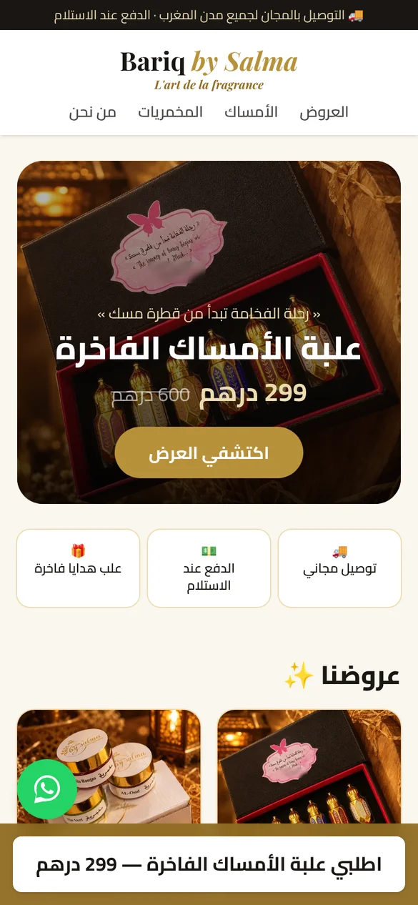
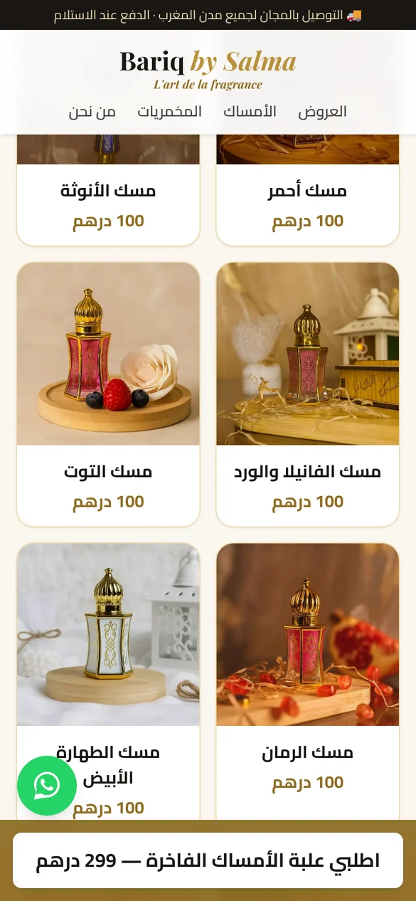
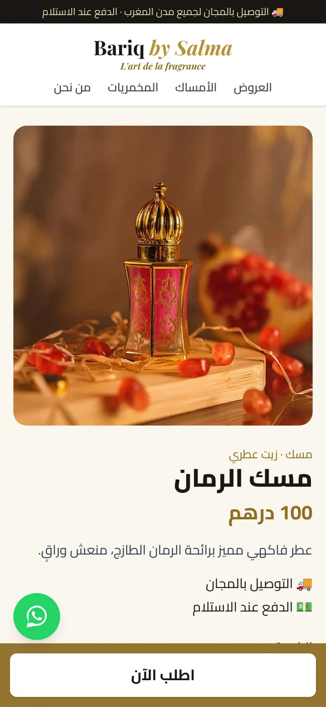
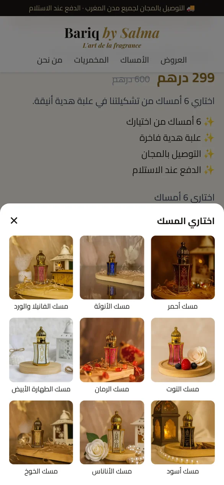
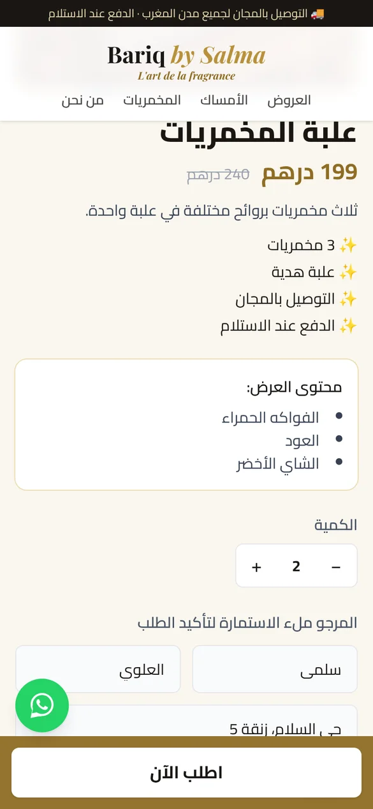
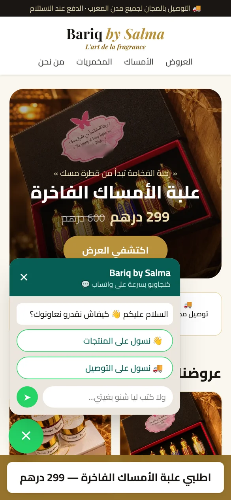
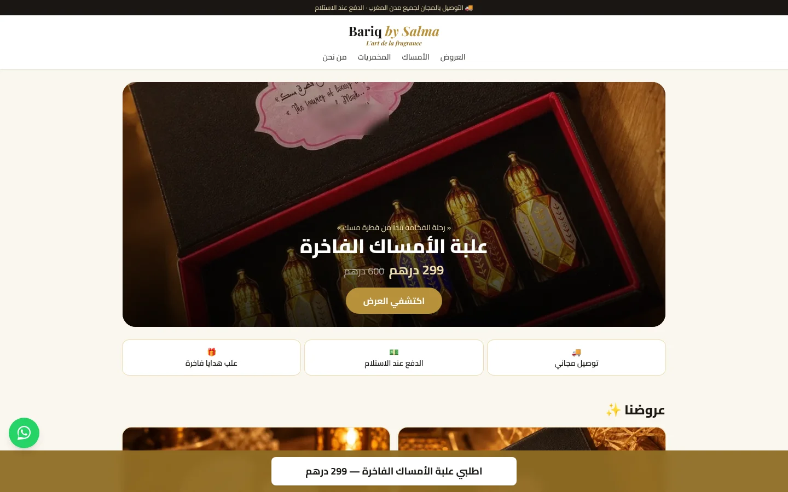
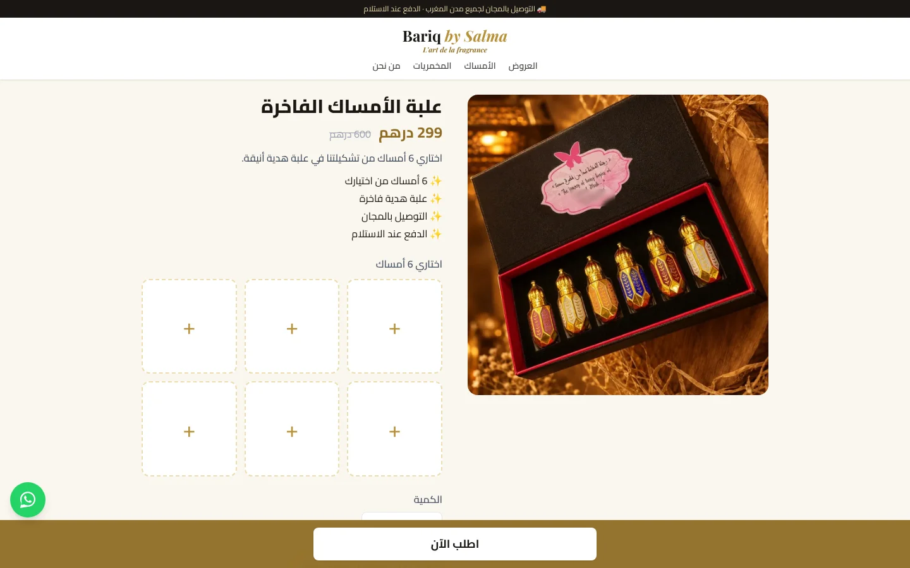
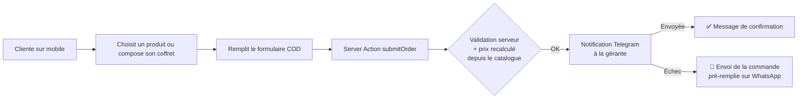

<div align="center">

# Bariq by Salma — Boutique en ligne

**Site e-commerce marocain de musc, huiles parfumées et parfums solides (mkhamriyat), avec paiement à la livraison.**

*« رحلة الفخامة تبدأ من قطرة مسك » — L'art de la fragrance*

[](https://nextjs.org)
[](https://react.dev)
[](https://www.typescriptlang.org)
[](https://tailwindcss.com)
[](https://www.netlify.com)

### 🔗 [Voir le site en ligne](https://bariqi.netlify.app)

</div>

---

## 📸 Aperçu

<table>
  <tr>
    <td align="center"><br><sub>Accueil</sub></td>
    <td align="center"><br><sub>Catalogue</sub></td>
    <td align="center"><br><sub>Page produit</sub></td>
  </tr>
  <tr>
    <td align="center"><br><sub>Coffret personnalisable (6 au choix)</sub></td>
    <td align="center"><br><sub>Formulaire de commande</sub></td>
    <td align="center"><br><sub>Contact WhatsApp rapide</sub></td>
  </tr>
</table>

<details>
<summary><b>Version ordinateur</b></summary>
<br>


</details>

---

## 🧭 Contexte

**Bariq by Salma** est une marque marocaine de musc et de parfums solides, qui vendait jusqu'ici surtout via Instagram et WhatsApp.

Le but du projet : donner à la marque une **boutique en ligne simple, rapide sur mobile et adaptée au marché marocain**, où la cliente commande en quelques secondes et **paie à la livraison** (COD), sans compte ni carte bancaire.

Le site est entièrement en **arabe (RTL)**, avec une identité visuelle noir / doré / crème fidèle aux coffrets de la marque.

## ✨ Fonctionnalités

- 🛍️ **Catalogue** : 9 musc (أمساك), 3 parfums solides (مخمريات) et 2 offres (العروض), avec page dédiée pour chaque produit.
- 🎁 **Coffret personnalisable** : la cliente choisit ses 6 musc dans une fenêtre de sélection (cases « + »), comme sur les grandes boutiques COD marocaines.
- 📝 **Commande en paiement à la livraison** : nom, adresse, ville (liste des villes du Maroc), téléphone et quantité, avec total calculé en direct.
- ✅ **Validation des numéros marocains** : accepte `06…`, `07…`, `05…`, `+212…` ou le numéro sans le 0.
- 🔔 **Notification instantanée** : chaque commande est envoyée sur **Telegram** à la gérante (et sur WhatsApp via CallMeBot en option).
- 🛟 **Plan B sans perte** : si la notification échoue, la cliente peut envoyer sa commande pré-remplie sur WhatsApp.
- 💬 **Bouton WhatsApp flottant** avec messages rapides en darija (« نسول على المنتجات », « نسول على التوصيل ») ou message libre.
- 📱 **Pensé mobile d'abord** : barre « اطلب الآن » toujours visible, images optimisées (WebP, `next/image`).

## 🛠️ Stack technique

| Domaine | Technologie |
|---|---|
| Framework | [Next.js 16](https://nextjs.org) (App Router, Server Components, Server Actions, Cache Components) |
| Langage | TypeScript |
| UI | React 19, [Tailwind CSS 4](https://tailwindcss.com) |
| Polices | Cairo (arabe) et Playfair Display via `next/font` |
| Notifications | API Bot Telegram, CallMeBot (WhatsApp, optionnel) |
| Hébergement | [Netlify](https://www.netlify.com), déploiement automatique depuis GitHub |
| Outils | pnpm, ESLint, Git |

## 🏗️ Comment fonctionne une commande



**Choix de sécurité :**

- La commande est traitée côté serveur (**Server Action**) : le token Telegram n'est jamais envoyé au navigateur.
- Le **prix est recalculé sur le serveur** à partir du catalogue : modifier le prix dans le navigateur n'a aucun effet.
- Les données sont **validées deux fois** : dans le navigateur pour le confort, et sur le serveur pour la sécurité.
- Les clés secrètes et les numéros de téléphone sont dans des variables d'environnement (`.env.local` en local, réglages Netlify en production), jamais dans le code.

## 📁 Structure du projet

```
src/
├── app/
│   ├── page.tsx                  # Accueil : bannière, offres, catalogue
│   ├── layout.tsx                # Squelette commun (RTL, polices, header, footer)
│   ├── packs/[slug]/page.tsx     # Page d'une offre / d'un coffret
│   ├── produits/[slug]/page.tsx  # Page d'un produit
│   └── actions/order.ts          # Server Action : validation + notifications
├── components/
│   ├── OrderForm.tsx             # Formulaire COD + sélection du coffret
│   ├── ProductCard.tsx           # Carte produit
│   ├── WhatsAppButton.tsx        # Bouton flottant + messages rapides
│   ├── StickyBuyBar.tsx          # Barre « اطلب الآن » fixe
│   ├── Header.tsx / Footer.tsx
├── data/products.ts              # Catalogue : produits, prix, descriptions, offres
├── config/site.ts                # Nom, slogan, numéro WhatsApp, réseaux sociaux
└── lib/cities.ts                 # Liste des villes de livraison
```

## 🚀 Lancer le projet en local

**Prérequis :** Node.js 22+ et [pnpm](https://pnpm.io).

```bash
# 1. Cloner le projet
git clone https://github.com/rflloubna-ui/bariq-by-salma-ecommerce.git
cd bariq-by-salma-ecommerce

# 2. Installer les dépendances
pnpm install

# 3. Créer le fichier des variables d'environnement
cp .env.example .env.local      # puis remplir les valeurs

# 4. Démarrer
pnpm dev
```

Le site est alors disponible sur [http://localhost:3000](http://localhost:3000).

### Variables d'environnement

| Variable | Rôle | Obligatoire |
|---|---|---|
| `TELEGRAM_BOT_TOKEN` | Token du bot Telegram (via [@BotFather](https://t.me/BotFather)) | Recommandé |
| `TELEGRAM_CHAT_ID` | ID du ou des destinataires, séparés par des virgules (via @userinfobot) | Recommandé |
| `CALLMEBOT_PHONE` | Numéro WhatsApp qui reçoit les notifications | Non |
| `CALLMEBOT_APIKEY` | Clé [CallMeBot](https://www.callmebot.com) | Non |
| `NEXT_PUBLIC_WHATSAPP_NUMBER` | Numéro WhatsApp du bouton vert, format `2126XXXXXXXX` | Recommandé |

Sans ces variables, le site fonctionne quand même : la commande passe directement par le plan B WhatsApp.

## ✏️ Personnaliser la boutique

| Je veux… | Fichier à modifier |
|---|---|
| Ajouter un produit, changer un prix ou une description | `src/data/products.ts` |
| Changer le numéro WhatsApp | variable `NEXT_PUBLIC_WHATSAPP_NUMBER` |
| Changer le slogan ou les réseaux sociaux | `src/config/site.ts` |
| Changer les messages rapides WhatsApp | `src/config/site.ts` → `whatsappQuickMessages` |
| Ajouter une ville de livraison | `src/lib/cities.ts` |
| Changer les couleurs | `src/app/globals.css` (`--color-gold`, `--color-ink`…) |

Les images des produits sont dans `public/products/` (format WebP, carré 1080 × 1080).

## ☁️ Déploiement

Le site est hébergé sur **Netlify** (offre gratuite) :

1. Netlify est relié au dépôt GitHub : chaque `git push` sur `main` met le site à jour automatiquement.
2. Les variables d'environnement sont configurées dans *Project configuration → Environment variables*.
3. Next.js est détecté automatiquement, aucune configuration supplémentaire n'est nécessaire.

## 🗺️ Prochaines étapes

- [ ] Enregistrer les commandes dans une base de données (Supabase) et ajouter un espace administrateur (suivi des statuts, export Excel pour le livreur)
- [ ] Pixel Meta / TikTok pour mesurer les campagnes publicitaires
- [ ] Nom de domaine `.ma`
- [ ] Version française du site

## 👩‍💻 Réalisé par

**Loubna Rhoufal** — Développeuse web

[](https://www.linkedin.com/in/loubna-rhoufal/)
[](https://github.com/rflloubna-ui)

---

<sub>Le code source est publié à titre de portfolio. Le nom, le logo, les photos et les textes de la marque appartiennent à **Bariq by Salma** et ne peuvent pas être réutilisés sans son accord.</sub>
